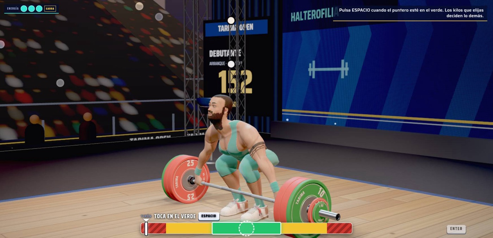
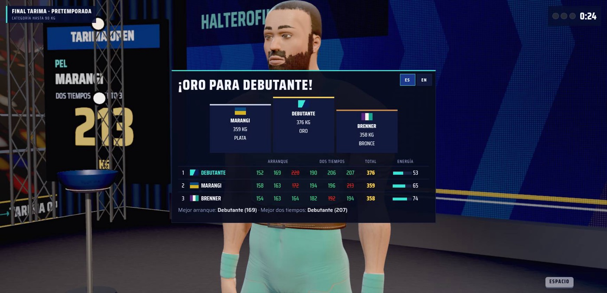

<div align="center">

# 🏋️ Tarima

**Juego web de halterofilia a un botón.** Una final de tres pesistas, arranque y dos tiempos, en el navegador.

### [▶ Jugar en liftinggame.pages.dev](https://liftinggame.pages.dev)

[](https://github.com/jvidelac1/tarima/actions/workflows/pruebas.yml)
[](https://github.com/jvidelac1/tarima/actions/workflows/telefono.yml)
[](https://github.com/jvidelac1/tarima/actions/workflows/servidor.yml)



</div>

## Cómo se juega

1. **Elegí tu pesista.** Compacto, Largo o Potente: cada uno tiene una fase fuerte y una débil, y su propio RM.
2. **Pedí los kilos.** El panel te dice qué porcentaje de tu RM es, si es fácil o muy difícil, y la chance de levantarlo.
3. **Tocá en el verde.** Con **Espacio** o **un toque** en el celular, cuando el puntero pasa por la zona verde. Una barrita
   en el arranque y dos en el dos tiempos. **Si todo sale en verde, la barra sube.** Si no, decide tu energía.
4. **Ganale a los rivales.** Tres intentos por levantamiento, el mejor total se lleva el oro. Cada rival tiene su estrategia:
   uno va a lo seguro, otro hace cuentas y otro arriesga.

La dificultad sale de las decisiones (pesista, kilos, riesgo y cansancio), no de la precisión de los dedos.

<div align="center">

</div>

## Qué tiene

- 3D en el navegador con three.js, sin build: personajes ficticios generados por script en Blender (MakeHuman/MPFB).
- Pensado para el celular acostado y para la computadora; inglés y español.
- Dificultad Fácil, Medio, Difícil y Clásico; energía y cansancio entre intentos; rivales con personalidad.
- Servidor en Cloudflare (Pages + Worker + D1): finales gratis contadas en el servidor y lista de espera por mail.
- Medición con PostHog sin la IP del jugador ni su mail.

## Correrlo local

```bash
git clone https://github.com/jvidelac1/tarima.git && cd tarima
cd web && python3 -m http.server 8000
# http://localhost:8000/juego.html              (sin servidor: se juega la final entera)
# http://localhost:8000/juego.html?muro=firme   simula el muro de producción
```

Pruebas sin navegador (Node 22):

```bash
npm ci
node tools/sim_test.mjs         # núcleo del juego y textos
node tools/servidor_test.mjs    # el Worker con una D1 falsa y el cliente del juego
node tools/barra_bots.mjs       # la barrita con bots de distinta puntería
```

Las pruebas con navegador (partida completa, teléfono, iPhone, muro) corren en GitHub Actions en cada push a `main`.

## Trabajar en el proyecto

**Empezá por [CONTEXTO.md](CONTEXTO.md)**: estado, backlog, cómo se trabaja acá, infraestructura y cómo publicar.
Después [AGENTS.md](AGENTS.md) (reglas) y [HANDOFF.md](HANDOFF.md) (historia y pendientes).

| Documento | Qué tiene |
|---|---|
| [docs/JUEGO.md](docs/JUEGO.md) | Diseño del juego: barrita, energía, pesistas, rivales, dificultad |
| [docs/MVP.md](docs/MVP.md) | Muro, servidor, privacidad y medición |
| [docs/CONTROLES.md](docs/CONTROLES.md) | Entrada: teclado y toques |
| [docs/VISOR.md](docs/VISOR.md) | Visor de personajes, build en Blender (macOS y Linux), modelos y estructura del repo |

## Licencias de terceros

- MPFB: código GPL-3.0, assets CC0. No está incluido en el repo, se clona aparte.
- Los personajes generados con los assets CC0 de MakeHuman no arrastran restricciones.
- three.js (MIT) y posthog-js (MIT) vendorizados en `web/vendor/`.
