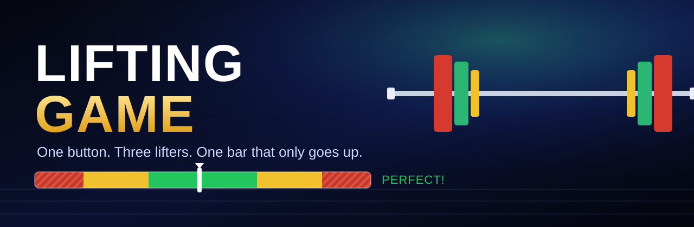

<div align="center">

<a href="https://liftinggame.pages.dev"></a>

### Olympic weightlifting, in your browser. One button. No install.

<a href="https://liftinggame.pages.dev"></a>

**522 lifters · 743 finals · 17+ countries — since launch on Nov 12, 2026.**

[](https://github.com/jvidelac1/tarima/actions/workflows/pruebas.yml)
[](https://github.com/jvidelac1/tarima/actions/workflows/telefono.yml)
[](https://github.com/jvidelac1/tarima/actions/workflows/servidor.yml)


</div>

## The final is on. You're up.

Three lifters. Snatch, then clean & jerk. Three attempts each. Best total takes gold.

- **Hit the green.** One tap (or **Space**) when the pointer crosses the green zone. Nail every bar in green and **the lift
  goes up — guaranteed.** Miss it, and it's your energy against the iron.
- **Call your weight.** Before every attempt you see your real odds of making it. Go heavy and you'll feel it on the
  next lift.
- **Pick your body.** **Compact** catches low and holds it overhead. **Long** pulls the bar sky-high but standing up hurts.
  **Powerful** stands up with anything — overhead is another story.
- **Read your rivals.** One plays it safe, one does the math, one goes all-in.

Easy to learn in five seconds. The strategy is in the numbers.

<div align="center">

</div>

## On the platform next

- 🏆 **Weekly championship** — the same final for everyone, one week to post your best total
- 🌍 **Global & country leaderboards** — championships won and best totals
- 📈 **Career mode** — win finals, raise your 1RM, climb weight classes
- 🏋️‍♀️ **Women lifters and weight classes**
- 📱 **Mobile app** — the players are voting right now (App Store / Google Play vs. web)

Get in early: **join the early-access list in-game** and play unlimited finals.

## Under the hood

- **3D in the browser**: three.js ES modules, no build step, playable on phone (landscape) and desktop, English & Spanish.
- **Fictional athletes generated by code**: bodies, rigs and lifts built procedurally in Blender (MakeHuman/MPFB), poses
  solved by rules and checked frame by frame. 7.9 MB download.
- **Server-side fairness**: Cloudflare Pages + Workers + D1; free plays are counted on the server, and every final can be
  recomputed from its record.
- **Privacy first**: analytics through our own proxy, without the player's IP or email.
- **Tested like a product**: bots with human-like timing, real-time input tests and full games in headless Chrome on every
  push (badges above).

## Run it locally

```bash
git clone https://github.com/jvidelac1/tarima.git && cd tarima
cd web && python3 -m http.server 8000
# open http://localhost:8000/juego.html  (no server: you play the whole final)
```

```bash
npm ci
node tools/sim_test.mjs        # game core and texts
node tools/servidor_test.mjs   # the Worker on a fake D1 with the real game client
node tools/barra_bots.mjs      # the timing bar with bots of different skill
```

## Contributing (people and AI agents)

**Start with [CONTEXTO.md](CONTEXTO.md)** — state, backlog, how we work, infrastructure and how to ship. Then
[AGENTS.md](AGENTS.md) and [HANDOFF.md](HANDOFF.md). Design docs (in Spanish): [docs/JUEGO.md](docs/JUEGO.md) (gameplay),
[docs/MVP.md](docs/MVP.md) (server, wall, privacy, analytics), [docs/CONTROLES.md](docs/CONTROLES.md) (input),
[docs/VISOR.md](docs/VISOR.md) (character viewer, Blender build, repo layout).

## Third-party licenses

MPFB: GPL-3.0 code, CC0 assets (not included; cloned separately). Characters generated from MakeHuman CC0 assets carry no
restrictions. three.js and posthog-js (MIT) vendored in `web/vendor/`.
